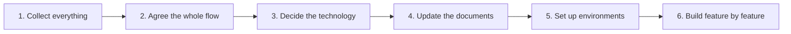

# 01 · Start-up plan (Phase 0)

**Goal of Phase 0:** get everything ready so the Ops system can be built safely, feature
by feature, without touching the live TA System. Phase 0 builds **no screens and no Ops
features**.

**The order of work (owner, 28 Oct):**

## The steps

| # | Step | What it means | Who | Needs | Status |
|---|---|---|---|---|---|
| 1 | **Repository** | This repository with rules and a reading order | Sanjeev | — | **Done 28 Oct** |
| 2 | **Collect and consolidate everything** | Canvas re-read, TA code re-checked, all decisions in one place, flow corrected with diagrams ([04](04-OPS-FLOW.md), [13](13-CORRECTIONS-LOG.md)) | Sanjeev | — | **Done 28 Oct** |
| 3 | **Architecture** | Ops is a separate system with its own backend and database, same server, connected by API ([02](02-ARCHITECTURE.md)) | Owner | — | **Decided 28 Oct** |
| 4 | **Agree the whole flow** | Walk the owner (and Asma, Rushda, the TA lead) through phases A to I of [04](04-OPS-FLOW.md); record every answer in [09](09-DECISIONS-AND-QUESTIONS.md) | Binath, Sanjeev, owner | Owner and Ops team time | **Next** |
| 5 | **Decide the technology** | For each feature, confirm or change the proposal in [06](06-FEATURES-AND-TECHNOLOGY.md) | Binath, Sanjeev, owner | Step 4 | Waiting |
| 6 | **Feature plans** | One plan per feature with the template in [10](10-FEATURE-PLANNING.md), starting with M1 Foundations | Binath, Sanjeev | Steps 4-5 | Waiting |
| 7 | **API contract, version 1** | The exact endpoints and events between Ops and TA ([03](03-CONNECTION-TO-TA.md)), agreed by both teams | Binath, Sanjeev | Step 6 | Draft in 03 |
| 8 | **Laptop set-up** | Empty Ops app and backend running on `127.0.0.1`, talking to a local copy of TA with a test key | Sanjeev | Step 5 | Waiting |
| 9 | **Staging** | A test copy of TA and Ops on the server; TA's old staging was stopped on 21 Sep | Binath, Sanjeev | **Owner's go-ahead** (server change) | Waiting |
| 10 | **Live server plan** | Ops backend container, database, address, firewall, backups (below) | Binath, Sanjeev | **Owner's go-ahead** | Draft below |
| 11 | **Release pipeline** | Checks on every pull request; a release step that needs approval, like TA's | Sanjeev | Step 8 | Waiting |
| 12 | **Outside approvals** | Requests that take days, started as soon as the flow is agreed (below) | Owner, Sanjeev | Owner | Waiting |

## Step 10 · Live server plan (draft, for the owner's approval later)

Same server as TA (VPS `<VPS_IP>`), every piece separate:

| Piece | Plan | TA's piece (untouched) |
|---|---|---|
| Ops backend | New Convex container in its own folder (for example `/opt/ops-prod`), bound to `127.0.0.1` on free ports | `career141-backend-1` (3210/3211) |
| Ops database | New database (for example `convex_ops`) in the same Postgres server | `convex_self_hosted` |
| Address | New names such as `ops-api.career141.com` through the same Caddy, with DNS records | `api.career141.com` |
| Firewall | New ports added to the existing firewall script so they are closed to the internet | Same script |
| Secrets | Own `.env` file readable only by root; own admin key | TA's file |
| Backups | Ops database in the Postgres backup; a backup before every live step | Same |
| Sign-in | Same Clerk as TA, so staff use one account (⚪ to confirm) | Clerk |

Before step 10: check the server's free memory and disk (a second backend uses more memory).

## Step 12 · Outside approvals

1. Microsoft admin consent for calendar and Teams links (interview booking). The longest wait.
2. Meta approval for the client WhatsApp templates (1-2 days each).
3. The final ESA template.
4. The invoice format: numbering, tax lines, currency, bank details.
5. The Sri Lankan public holiday list.
6. Who gets which Ops role.
7. Whether the website form can send leads to the system.

## Phase 0 is finished when

- [x] The repository exists with rules and a reading order.
- [x] Everything collected and consolidated; the flow corrected with diagrams.
- [x] The architecture is decided.
- [ ] The whole flow is agreed with the owner and the Ops team.
- [ ] The technology for each feature is decided.
- [ ] Every feature has an agreed plan.
- [ ] API contract version 1 is agreed by both teams.
- [ ] The empty Ops app and backend run on the laptop and talk to a local TA.
- [ ] Staging is running, or the owner has chosen a supervised pilot.
- [ ] The live server plan is approved.
- [ ] The outside approvals are requested.
