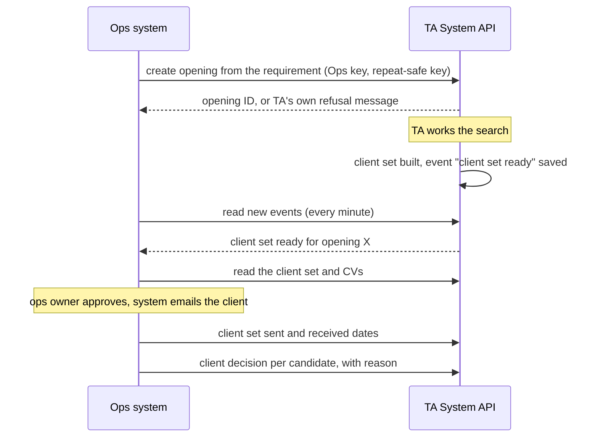

# 02 · Architecture

**Decision (owner, 28 Oct 2026):** the Ops system is a **separate service** with its
own code, its own backend and its own database. It runs on the same server as the
TA System and talks to TA **only through TA's API**. The live TA System is not
changed, apart from small new API endpoints added to it.

## The problem this solves

The TA System is live and the recruiters use it every day. We must add a whole new
system for the client side, sharing information with TA, **without any risk to TA**.

## The design

```
          ops-system repo                        ta-system repo (live)
┌──────────────────────────────┐   API (v1)   ┌──────────────────────────────┐
│ Ops screens   (Next.js)       │ ───────────▶ │ TA API (read + new write     │
│ Ops backend   (Convex)        │ ◀─────────── │ endpoints, events list)       │
│ Ops database  (convex_ops)    │   events     │ TA backend + database         │
└──────────────────────────────┘              └──────────────────────────────┘
          Same VPS · same Postgres server · separate backend and database
```

The separate system is **decided**. The tools in the table below are **proposals**: the
same tools as TA, because the team already knows them. They are confirmed after the
whole flow is agreed (order of work in [01](01-STARTUP-PLAN.md)).

| Part | Proposed | Why |
|---|---|---|
| Code | This repository, `career141-dev/ops-system` | Ops team works and releases on its own |
| Backend | Its own self-hosted Convex | Same tool as TA, so the team already knows it |
| Database | Its own database inside the same Postgres server | One backup routine; Ops is light. Moves to its own Postgres if it ever gets heavy |
| Screens | Next.js 16, built later by the UI team | Same as TA |
| Sign-in | Clerk, the same staff accounts as TA (to confirm) | One login for staff |
| Email | Microsoft Graph, from Ops mailboxes | Same as TA |
| WhatsApp | Meta WhatsApp Cloud API with approved client templates | Same as TA |
| Files | Cloudflare R2 (agreements, invoices, offer letters) | Same as TA |
| Link to TA | TA's API, version 1, with an Ops-only key | Safe, controlled, versioned |

## How the two systems talk

- **Ops asks TA** (reading): clients, openings, client CV sets, pipeline counts,
  interviews, placements. Reading already exists in TA's partner API.
- **Ops sends TA** (writing): create an opening from a requirement, client
  decisions on CVs, interview bookings, holds and closes. These are **new**
  endpoints added to TA.
- **TA tells Ops** (events): "client set ready", "offer made", "placement made",
  "candidate dropped out". TA writes them to an events list; Ops checks the list
  every minute, so TA never waits for Ops.
- **No copies:** each side stores only the ID of the other side's records.



Details: [`03-CONNECTION-TO-TA.md`](03-CONNECTION-TO-TA.md).

## Options we did not choose

| Option | Why not |
|---|---|
| Ops code inside the TA backend | Every Ops release would also be a TA release, and an Ops mistake could break live TA |
| A second repository deploying into the TA backend | A Convex deploy replaces every function in the backend, so it would wipe TA |
| Ops reading TA's database directly | Not possible with Convex, and unsafe even where it is possible |
| Ops on a separate server and database provider | Extra cost and another server to manage, for no gain at this size |

## Environments

| Environment | Where | What it is for |
|---|---|---|
| Laptop | `127.0.0.1` only | Building and testing, with a local copy of TA |
| Staging | Server, test addresses | Trying changes on a test copy before live. To be rebuilt (stopped 21 Sep) |
| Live | Server, live addresses | Real use, released with the owner's go-ahead, Ops switched off until the pilot |

## Safety built into the design

- **TA changes only by adding.** New endpoints and events only. Nothing existing is
  changed or removed. Each change is small, released on its own, and easy to undo.
- **Ops has its own on/off switch.** Ops goes live switched off, then is turned on
  for one client (the pilot), then for everyone.
- **Every client message is checked.** Drafted, approved by a person where the rules
  say so, and sent through the outbound safety checks; test recipients until switched live.
- **Background jobs are small.** Ops jobs run in small batches with their own switch,
  so they cannot slow the shared server.
- **Backup first.** A full database backup before every live step.

## Lessons from the TA System, built in from day one

- One reader per mailbox, small batches, and an alert if reading stops (a mailbox
  went unread for 18 days in October).
- Messages matched by a reference, never by guesswork (replies were once filed
  against the wrong opening).
- Business numbers (days, limits, percentages) kept in settings, not in code (TA's
  workday rules changed several times in one week).
- Every failure saves its reason.
- Releases only through the pipeline (a laptop deploy once overwrote the live backend).
