# 04 · The whole flow: from a new client to the end of the guarantee

This is the **corrected, consolidated flow** of both systems working together. It is
built from:

- the owner's planning canvas, re-read on 28 Oct 2026 (59 cards, unchanged since
  27 Oct): the newest two-system flow **c5237** (250 steps, 332 arrows), the locked
  business flows **c3626**, **c3002**, **c2790**, today's ops workflow **c719**, and
  the dated notes of 20, 22, 23 and 26 Oct;
- the 27 Oct analysis (corrected arrow labels, design gaps, settled conflicts), see
  [`reference/ANALYSIS.md`](reference/ANALYSIS.md);
- how the TA System really works today (checked in its code), see
  [08](08-TA-SYSTEM-FOR-OPS.md).

Where this page differs from the canvas, the difference is listed in section 12 and
in [13](13-CORRECTIONS-LOG.md). **Every step is still a draft until the owner and the
Ops team agree it** (Phase 0, step 3).

**Labels:** 🟦 **Ops** = Ops system · 🟩 **TA** = TA System · 🔁 **Link** = a hand-over
through the API · ⚪ **Open** = not decided yet.

**One pattern repeats everywhere:** a message to a client is **drafted by the system →
checked and approved by the ops owner → sent by the system**. Routine notices
(candidate rejection notices, interview invites and reminders, internal alerts) go
automatically from one approved template.

---

## 1. The big picture

The client comes **first into the Ops system**. Only when the client has signed the
agreement and the requirement meeting has happened does the position open in the
**TA System**. Ops stays with the client the whole time; TA works the candidates.

```mermaid
flowchart LR
  subgraph OPS1["🟦 Ops: before the opening"]
    A["New lead"] --> B["Client check"] --> C["Intro call"] --> D["Client agreement ESA"] --> E["Requirement meeting"]
  end
  subgraph TA1["🟩 TA: the search"]
    F["Opening created"] --> G["JD and LinkedIn advert"] --> H["CVs, scoring, follow-up"] --> I["Director set"]
  end
  subgraph MID["🟦🟩 Together: client side of the search"]
    J["Client CV set"] --> K["Client feedback"] --> L["Interviews"] --> M["Offer and placement"]
  end
  subgraph OPS2["🟦 Ops: after the placement"]
    N["Joining day"] --> O["Invoice and payment"] --> P["90-day guarantee"] --> Q["Position closed"]
  end
  E -- "🔁 requirement → opening" --> F
  I -- "🔁 client set ready" --> J
  M -- "🔁 placement made" --> N
  P -- "🔁 candidate left → reopen" --> H
```

| Phase | Owner | Section |
|---|---|---|
| A. New lead and client check | Ops | 2 |
| B. Intro call and client agreement (ESA) | Ops | 3 |
| C. Requirement meeting → position opens in TA | Ops → TA | 4 |
| D. Adverts, CVs, follow-up, Director set | TA (Ops runs extra adverts) | 5 |
| E. Client CV set, ownership, feedback, pipeline depth | TA → Ops → TA | 6 |
| F. Interviews and reference check | Ops + TA | 7 |
| G. Offer, placement, joining day | TA → Ops | 8 |
| H. Invoice and payment | Ops | 9 |
| I. Guarantee and close | Ops (+ TA for replacements) | 10 |

---

## 2. Phase A · New lead and client check (Ops)

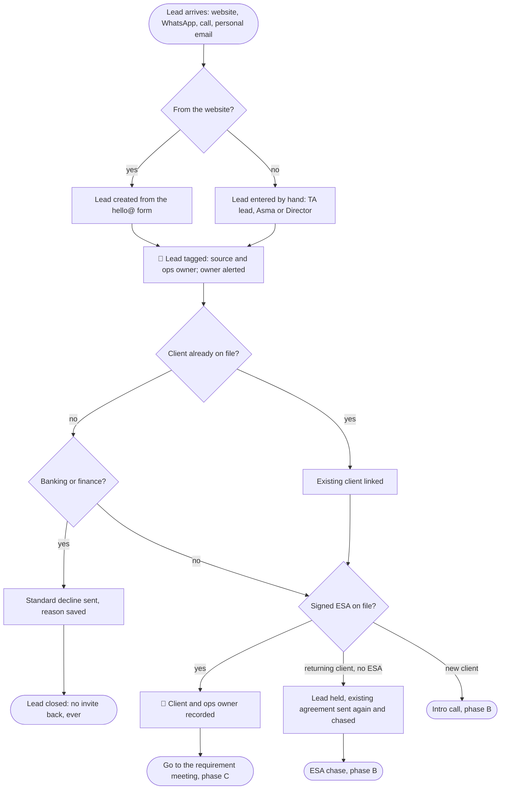

- **One ops owner per client**, movable by the ops lead. The owner is alerted the
  moment a lead is tagged to them.
- The duplicate check uses the client's name key (the TA System already matches names
  ignoring case and punctuation).
- Banking/finance is flagged by AI and confirmed by a person; the decline is a fixed
  template.

## 3. Phase B · Intro call and client agreement (Ops)

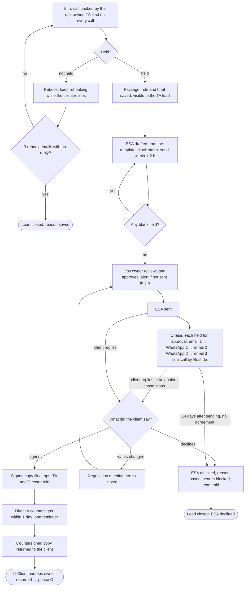

- **Numbers:** send within 1-2 hours of the intro call (alert at 2 h); chase 3 emails +
  2 WhatsApps + a call; declined 14 calendar days after sending with no agreement;
  Director countersigns within 1 day.
- **The team is told when the client signs,** before the Director countersigns, so
  the requirement meeting can be booked.
- **ESA terms decide the money later:** fee rule, guarantee days, payment terms.
  They are saved with the agreement and sent to TA, because TA copies them onto the
  placement when the TA presses Place.
- ⚪ No escalation is decided if the Director does not countersign after the reminder.

## 4. Phase C · Requirement meeting → the position opens in TA

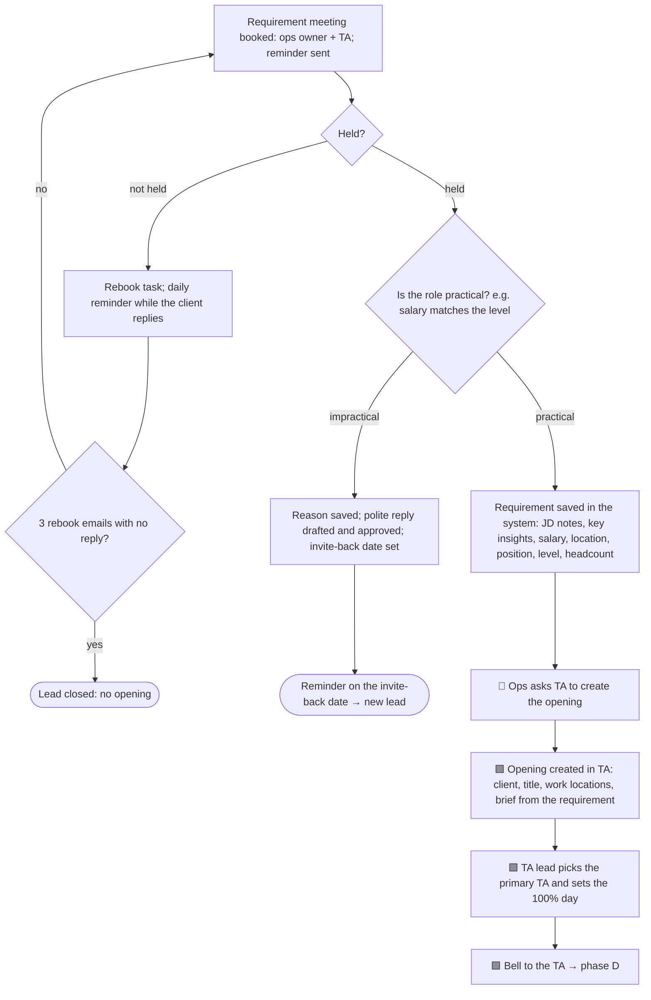

**How the position opens, in practice:**

1. In Ops, the ops owner saves the requirement and presses **Create opening in TA**.
2. Ops calls TA's API. TA creates the opening exactly as its own *New opening* page
   does today: the client is required, the title, country, nationality, work
   locations; the requirement notes become the opening's **brief**; the JD starts as
   "waiting for TA approval"; a first job post is made; priority starts at P3
   (P1 = 14 days ... P5 = 60 days target).
3. The **TA lead** chooses the primary TA (and supporting TAs) and the 100% day. The
   TA gets a bell.
4. TA sends back the opening's ID; Ops stores it on the requirement and the client.
   From now on Ops reads the opening from TA and never copies it.

⚪ **To settle:** one 100% position per TA per day (canvas) or up to five (TA change of
27 Oct, commit `9bfb190`).

## 5. Phase D · Adverts, CVs, follow-up and Director set (TA, with Ops adverts)

This is the TA System's existing work. Ops only adds TopJobs and Talent Pulse.

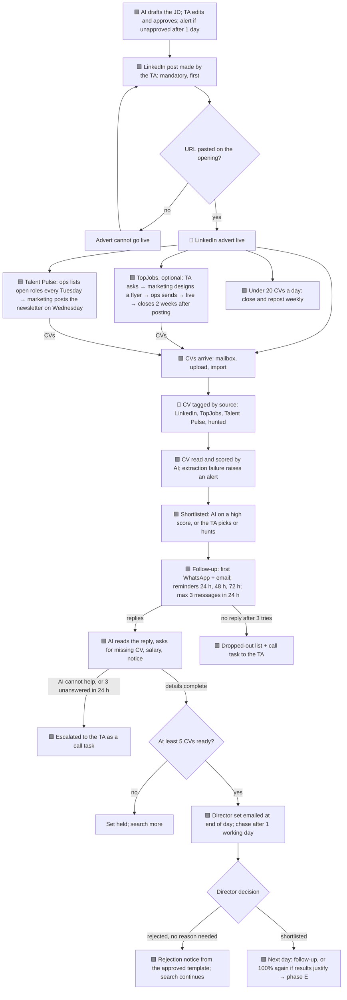

- The **weekly active-positions report** to Mr Azeem is a **desk-level** weekly job
  (one report, owned by the TA lead), not something each advert triggers (correction).
- TopJobs takes flyers only (5,400 per ad; 12,700 for the HR + marketing ad).
- ⚪ Talent Pulse: one tracked apply link per role is a guess to confirm.

## 6. Phase E · Client CV set, ownership, feedback and pipeline depth

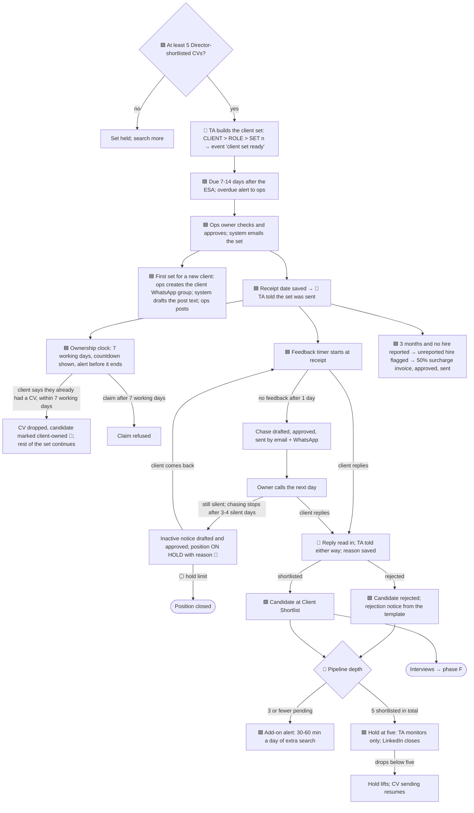

- **Silence rule (decided 27 Oct):** one clock of **14 calendar days after profiles are
  shared** (the ESA's inactivity rule) leads to the hold; inside it, chase after 1 day,
  call the next day, stop chasing after 3-4 silent days.
- ⚪ How long a hold lasts before the position closes is not decided.
- ⚪ The surcharge invoice has no chase or payment path yet.

## 7. Phase F · Interviews and reference check (Ops + TA)

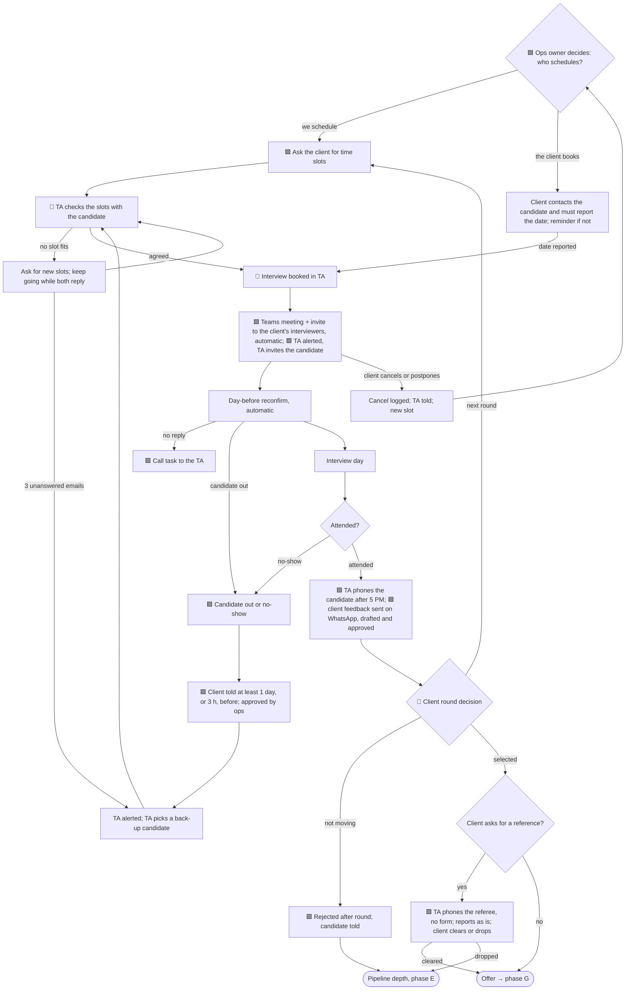

- **One interview record, two teams:** the record lives in TA; Ops books the client
  side through the API, TA handles the candidate. **The candidate never gets a message
  from Ops.**
- Invites and reminders go automatically; the ops owner handles the exceptions.
- Rebooks are for client meetings, not for candidate rebooks.

## 8. Phase G · Offer, placement and joining day (TA → Ops)

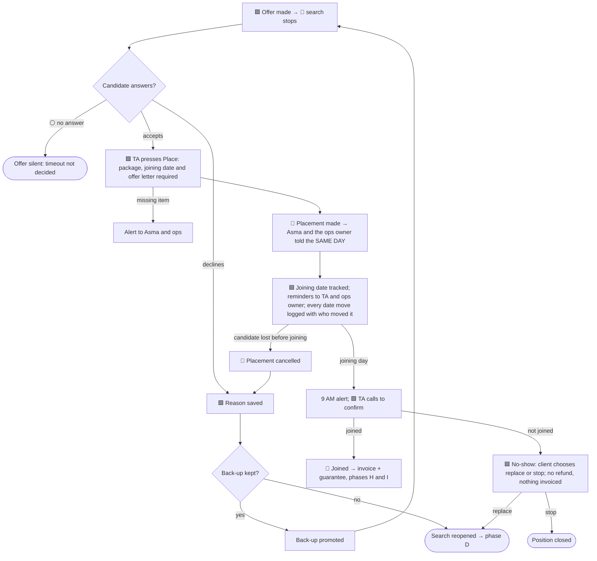

- Today Asma learns about joinings months late (once, a January joining on 30 March).
  The same-day notice fixes that.
- The TA System today saves only the joining date at Place, and Place opens a page that
  does not exist; both are fixed in TA (adding the required fields and the page).

## 9. Phase H · Invoice and payment (Ops)

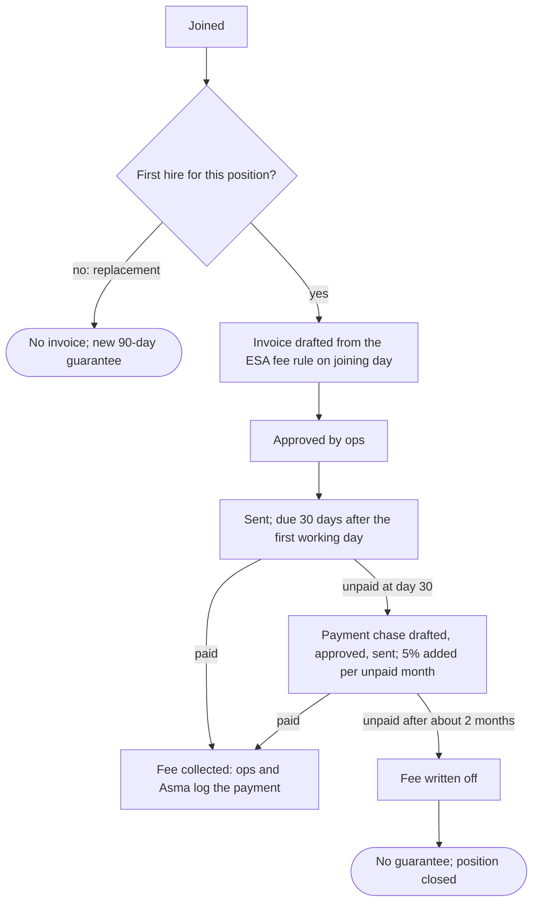

- **Fee rule:** one month's gross salary as standard (basic only for selected clients;
  the ESA draft also has 2 months for a non-Sri-Lankan). It comes from the client's ESA.
- ⚪ 5% simple or compounded (the ESA says compounded): owner or legal to decide.
- ⚪ Invoice numbering, tax lines, currency, bank details. No accounting tool yet: CSV export.

## 10. Phase I · Guarantee and close (Ops, TA for replacements)

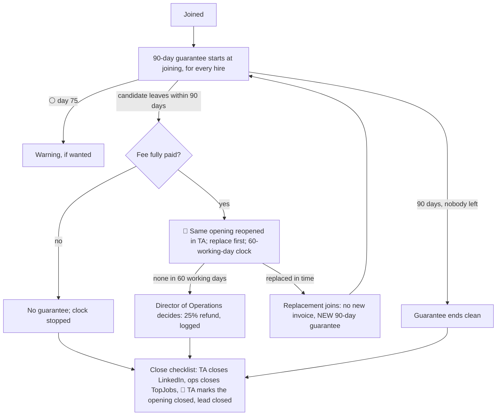

- **Decided:** the guarantee starts at joining, not at payment, and is valid only if the
  fee is fully paid; the position closes when the guarantee ends (or at refund or
  write-off); a replacement starts a new guarantee with no new invoice.
- **Correction:** on the canvas only the replacement's guarantee had the leave / day 75 /
  clean branches; a first hire's guarantee now has them too.
- ⚪ A client deadline to choose replace or stop is not decided.
- The TA System today raises "refund or free re-run due" at once when a placed candidate
  leaves; that rule changes to **replace first**.

---

## 11. The position's status, across both systems

One position moves through these states. Ops shows the whole life; TA shows its part
with its own statuses (open, on hold, placed, closed).

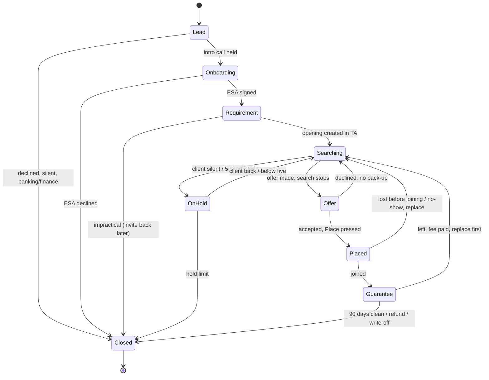

| Combined status | TA's status | Who acts |
|---|---|---|
| Lead, Onboarding, Requirement | (no opening yet) | Ops |
| Searching | Open | TA, with Ops on the client side |
| On hold | On hold | Ops decides, TA monitors |
| Offer | Open | TA |
| Placed, Guarantee | Placed (set by Ops when the candidate joins) | Ops; TA for replacements |
| Closed | Closed | Ops triggers, TA closes the opening and its posts |

Note: in the TA System today, placing a candidate does **not** mark the opening Placed;
someone must change it by hand. With the connection, Ops sets it through the API.

## 12. Corrections made to the canvas flow (summary)

| # | On the canvas (c5237) | Corrected here |
|---|---|---|
| 1 | A first hire's 90-day clock had no leave / day-75 / clean branches | Every hire's guarantee has them (section 10) |
| 2 | "Fee collected" ended the flow, while the locked flow closed the position at fee | Position closes at guarantee end, refund or write-off (decided 27 Oct) |
| 3 | "Escalated to TA" was a dead end | It becomes a call task for the TA (section 5) |
| 4 | Only the 48 h and 72 h reminders led to "reply read" | A reply at any point stops reminders (section 5) |
| 5 | Director rejection fed the client pipeline count | Director rejection only continues the search; client counts come from client decisions |
| 6 | The weekly report hung off each LinkedIn advert | One weekly desk report (section 5) |
| 7 | "Set reviewed, none shortlisted" led into scheduling | Removed: no shortlist, no interview |
| 8 | About 35 arrow labels sat on the wrong arrow | Placed on the right arrows (list in [13](13-CORRECTIONS-LOG.md)) |
| 9 | Returning client without an ESA jumped into the chase | The existing agreement is sent again first, then chased |
| 10 | Reference check with a 1-10 form (older cards) | Phone call only when the client asks (26 Oct) |

## 13. All the numbers in one place

| Rule | Number | Source |
|---|---|---|
| ESA sent after the intro call | 1-2 hours (alert at 2 h) | canvas |
| ESA chase | 3 emails + 2 WhatsApps + final call (Rushda) | canvas |
| ESA declined | 14 calendar days after sending, no agreement | settled 27 Oct |
| Director countersigns | within 1 day, one reminder | canvas |
| Rebook emails before closing a lead | 3 (intro call and requirement meeting) | 26 Oct |
| JD unapproved alert | after 1 day | canvas |
| Candidate follow-up | reminders at 24/48/72 h, max 3 messages in 24 h | 26 Oct |
| Director set and client set | at least 5 CVs | 26 Oct |
| Director chase | after 1 working day | canvas |
| Client set due | 7-14 days after the ESA | canvas |
| Client claim on a CV | within 7 working days of receipt | canvas |
| Client feedback | chase after 1 day, call next day, stop after 3-4 silent days | 26 Oct |
| Silence → hold | 14 calendar days after profiles shared (ESA) | settled 27 Oct |
| Pipeline depth | add-on at 3 or fewer pending (30-60 min/day); hold at 5 shortlisted | canvas |
| Client told of a drop-out | at least 1 day, or 3 hours, before | canvas |
| Interview feedback call | after 5 PM | canvas |
| Joining-day alert | 9 AM | canvas |
| Unreported hire | 3 months, 50% surcharge | ESA |
| Invoice | on joining day, due 30 days; 5% per unpaid month; written off after about 2 months | canvas, ESA |
| Guarantee | 90 days from joining; replace within 60 working days, else 25% refund | ESA, canvas |
| TopJobs | closes 2 weeks after posting | 26 Oct |
| LinkedIn | under 20 CVs a day = repost weekly; closes when monitor-only | 26 Oct |
| Talent Pulse | list Tuesday, newsletter Wednesday | canvas |
| Priority targets (TA) | P1 14, P2 21, P3 30, P4 45, P5 60 days | TA code |

The flow diagrams as raw step lists are in [`reference/walkthroughs/`](reference/walkthroughs/).
