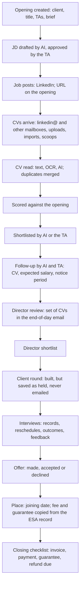

# 08 · How the TA System works today, and what Ops reuses

Checked against the TA System's code on `main` (27-28 Oct 2026). **Exists** = TA already
does it; **extend** = TA has part of it; **new** = nobody does it yet.

## 1. The TA System in short

- Live since 21 Sep 2026 at https://ta-system.career141.com, 78,000+ candidates.
- Next.js 16 app on a self-hosted Convex backend (116 tables) on the VPS.
- Microsoft 365 mail (Graph), Meta WhatsApp, Clerk sign-in, Cloudflare R2 files, Qdrant
  for meaning search, AI through Claude first and DeepSeek second.
- Roles: admin, director, ta_lead, ta, ta_support, ops, client, viewer.

## 2. How a position opens in TA today

Today a TA lead (or a TA) opens a position by hand on **New opening**:

1. Choose the **client** (required; a lead, director or admin can add a new client) and the
   **position title**; country (default Sri Lanka), nationality, work locations, notes or a
   voice brief.
2. A lead picks the **TAs**; a TA opening it is assigned to themselves.
3. TA creates the opening: status **open**, JD **waiting for TA approval**, priority **P3**
   (P1 14 days, P2 21, P3 30, P4 45, P5 60 days target), a first job post, and the notes as
   a **brief**. The first TA is the primary recruiter; the TA lead is set once and has no
   edit screen.
4. The TA writes the JD (AI drafts it) and approves it. Only then can an advert go live
   and CV scoring start.

**With Ops:** steps 1-3 happen through TA's API when the ops owner presses *Create opening
in TA* after the requirement meeting ([04](04-OPS-FLOW.md), phase C). The requirement
becomes the brief; the TA lead still picks the TAs and the 100% day.

## 3. The TA flow today

**Candidate stages** (what TAs see → stored name):
New CVs → Matched → AI follow-up → TA follow-up → **Director review** → **Director
shortlist** → **Client shortlist** → **Interview** → **Offer** → **Placed**; plus Rejected
and Dropped out. The last four are exactly where Ops and TA meet. To enter Director
review a candidate needs a CV, expected salary and notice period.

**Opening statuses:** open, on hold, placed, closed. There is no "cold" status. Placing a
candidate does **not** mark the opening Placed (someone changes it by hand). Only *open*
openings get the follow-up sweep and alerts; *on hold* openings accept CVs only through
their advert links.

**Working modes per TA per opening:** 100% (full hunt), Follow-up, Add-on. Saving an
opening's team resets everyone to 100% (known quirk).

## 4. Fit-gap: what Ops needs, what TA has

| Ops need | TA today | Verdict |
|---|---|---|
| Leads, website form, duplicate-client check, banking/finance flag | Clients list with a name key that ignores case and punctuation; no leads | **New** (Ops) |
| ESA draft, chase, countersign, decline | An ESA table and status logic exist, but no screen uses them; the client editor only has a signed date | **New** (Ops), ESA status and terms written to TA |
| Ops owner per client, Ops roles | `ops` role exists (sees every opening) but **cannot create or edit clients**; no ops owner field | **Extend** (TA field) + **new** (Ops roles) |
| Requirement → opening, primary TA, 100% day | New opening, team seats, working modes exist | **Exists**, needs an API endpoint |
| JD approval, LinkedIn post and URL | Exists; an advert cannot go live before the JD is approved | **Exists** |
| TopJobs and Talent Pulse, source tags | Adverts are LinkedIn only; source tagging partial | **New** (Ops) + **extend** (TA source) |
| CV intake, scoring, follow-up, drop-outs | Exists | **Exists** |
| Director set | Exists (end-of-day email, reply reading) | **Exists** (minimum 5 CVs to check) |
| Client CV set by email, 7-day ownership | Client round built but saved as "held", never emailed | **Extend** (TA event) + **new** (Ops sending) |
| Client chase, silence hold, pipeline depth | Some alerts (client chase after 2 working days); working modes exist; no count rule | **Extend** |
| Interview booking, slots, reminders, Teams | Interview records and actions, plus alerts (day-of confirmation, escalation under 4 h, follow-up); no slots, invites, Teams, automatic reconfirm or client notices | **Extend** (TA endpoint) + **new** (Ops booking) |
| Reference check when the client asks | Referee tools exist on the sourcing side | **Extend** |
| Offer, Place with package, joining date, offer letter | Offer and Place exist; Place saves the joining date only and opens a page that does not exist | **Extend** (TA fix) |
| Asma and Ops told the same day | Not today | **New** (TA event + Ops notice) |
| Joining day 9 AM call | Joining-date alerts exist ("starts today" at 9 AM Colombo) | **Exists** |
| Invoices, payments, late charge, write-off | Placement has invoice fields and a closing checklist; no invoice screen | **New** (Ops) |
| 90-day guarantee, replace first, 25% refund | Guarantee end = joining date + guarantee days; "refund or free re-run" raised at once, against the ESA | **New** (Ops) + **TA rule fix** |
| Weekly report to Mr Azeem | Reports page, Master Sheet, CSV; no scheduled report | **Extend** |
| Ops inbox and escalations | TA's alerts go to recruiters and TA leads; an Ops dashboard exists (clients, alerts, interviews) | **New** (Ops) |
| Safety for client messages | Outbound safety checks exist; outreach off by default | **Exists** (Ops copies the approach) |

## 5. Things in TA that Ops must never break

- TA's release pipeline, backend and database: nothing from Ops deploys to them.
- The Capacity Planner's partner API and key: Ops gets its own key and endpoints.
- TA's candidate messaging: the candidate never receives a message from Ops.
- TA's rules (collision lock, Director-review details gate, workday rules): Ops writes go
  through TA's own rules and get TA's own refusal messages.

## 6. TA issues found that matter for Ops

| Issue | Effect | Fix |
|---|---|---|
| Place redirects to a page that does not exist | The placement saves, but the TA lands on "not found" | TA fix |
| Ops cannot create or edit clients | Ops owners cannot own clients in TA | Solved by the API (Ops writes clients) |
| ESA table unused | Fee and guarantee at Place come from an empty record | Ops writes ESA terms through the API |
| Refund raised at once | Against the ESA (replace first) | TA rule fix |
| Saving a team resets every TA to 100% | Mode lost | TA fix (TA work plan) |
| The opening's TA lead cannot be changed | Wrong lead gets alerts | TA fix (TA work plan) |
